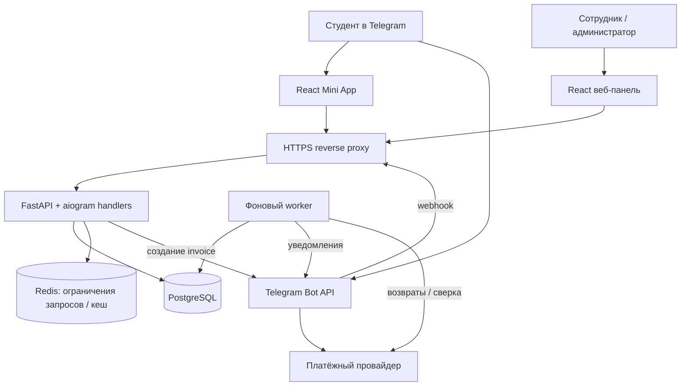

# Архитектура Cofmart

Дата: 11 ноября 2026 года. Статус: предлагаемая архитектура MVP.

Основание: ТЗ «Предзаказ кофе к перерыву через Telegram» из файла `README (2).md`. Ниже требования ТЗ дополнены техническими решениями; организационные вопросы перечислены отдельно. Документ описывает будущую систему, а не уже реализованные функции.

## 1. Подход

Для пилота на одной, затем трёх кофейнях предлагается **модульный монолит**: единая Python-кодовая база, PostgreSQL и два клиентских приложения. HTTP API и обработчики Telegram работают в одном приложении; фоновые операции запускаются отдельным процессом из той же кодовой базы.

Модули общаются через прикладные сервисы, а не через внутренние HTTP-запросы. Бизнес-правила не размещаются в React, Telegram-обработчиках или ORM-моделях.

Основные инварианты:

- Один заказ относится к одной кофейне, одному продавцу и одному перерыву.
- В MVP один заказ занимает один слот. Ограничение числа товаров в заказе настраивается отдельно, иначе один большой заказ может перегрузить точку.
- Число принятых заказов и действующих резервов не превышает лимит.
- Оплата подтверждается серверным событием, а не ответом интерфейса Mini App.
- Оплаченный заказ не переносится в другую кофейню автоматически.
- Повторные запросы, события и фоновые задания не создают повторного заказа, списания мощности или возврата.

## 2. Компоненты



Внешние уведомления провайдера, если они доступны для выбранной схемы подключения, поступают через отдельный защищённый webhook API. Telegram и провайдер могут сообщать об одном платеже: это разные источники событий одного платёжного объекта.

| Компонент | Выбор для MVP | Назначение |
| --- | --- | --- |
| Mini App | React, TypeScript, Vite | Кофейни, меню, корзина, оформление, статус |
| Веб-панель | React, TypeScript, Vite | Очередь кофейни и административные настройки |
| Клиентские запросы | TanStack Query, типы из OpenAPI | Серверное состояние, повторные загрузки, согласованный контракт |
| Backend | FastAPI, Pydantic, aiogram | REST API, проверка доступа, Telegram webhook |
| Работа с БД | SQLAlchemy, asyncpg, Alembic | Транзакции, запросы, миграции |
| Основная БД | PostgreSQL | Заказы, деньги, резервы, расписание, события |
| Redis | Необязателен для первого запуска | Rate limiting и кратковременный кеш; не источник слотов |
| Фоновые операции | Python worker + таблица outbox | Уведомления, возвраты, освобождение резервов, сверка |
| Развёртывание | Docker Compose, Caddy или Nginx | Один сервер с HTTPS для пилота |

В репозитории сейчас только стартовый `main.py` и `pyproject.toml` без зависимостей; задан Python >=3.14. Перед фиксацией окружения нужно проверить совместимость выбранных версий библиотек и образа Python. Архитектура не требует конкретной минорной версии.

## 3. Модули backend

| Модуль | Ответственность |
| --- | --- |
| `identity` | Проверка Telegram initData, сессии, пользователи, роли и доступ к точкам |
| `cafes` | Кофейни, этажи, режим работы, продавцы и остановка приёма |
| `catalog` | Меню, цены, доступность товаров |
| `schedule` | Шаблоны расписания, исключения по датам, конкретные перерывы |
| `capacity` | Лимит на кофейню и перерыв, атомарные резервы |
| `orders` | Состав и стоимость заказа, переходы статусов, выдача и отмена |
| `payments` | Попытки оплаты, invoice, подтверждения, сверка и возвраты |
| `notifications` | Outbox и доставка сообщений через бота |
| `reporting` | Показатели пилота на основе истории событий |
| `audit` | История действий сотрудников и изменений настроек |

Слои внутри модуля: `api/handlers → service → repository`. Прикладной сервис управляет транзакцией; репозитории не делают независимый commit. Общий `core` содержит только инфраструктуру: настройки, соединения, журналирование, часы и ошибки.

## 4. Структура репозитория

```text
cofmart/
├── apps/
│   ├── miniapp/src/          # Студенческий интерфейс
│   └── dashboard/src/        # Сотрудники и администратор
├── packages/
│   └── api-client/           # TypeScript-клиент из OpenAPI
├── backend/
│   ├── src/cofmart/
│   │   ├── main.py           # FastAPI и подключение webhook
│   │   ├── worker.py
│   │   ├── core/
│   │   ├── modules/          # Перечисленные бизнес-модули
│   │   └── integrations/
│   │       ├── telegram/
│   │       └── payments/
│   ├── migrations/
│   └── tests/
├── infra/
│   ├── compose.yaml
│   └── Caddyfile
├── docs/
│   └── ARCHITECTURE.md
├── .env.example
└── pyproject.toml
```

Это проектируемая структура. Существующие файлы документом не перемещаются.

## 5. Модель данных

Время хранится как `timestamptz` в UTC, расписание интерпретируется в настраиваемой IANA-зоне учебного заведения. Сервер определяет, закрыт ли приём; часы телефона не используются для принятия решений. Денежные суммы — целые значения в минимальных единицах валюты, для RUB в копейках.

| Таблица | Ключевые поля и связи |
| --- | --- |
| `users` | UUID, уникальный `telegram_id` BIGINT, имя, время создания |
| `sessions` | Пользователь, хеш случайного токена, срок действия, отзыв |
| `staff_memberships` | Пользователь, кофейня, роль; уникальная пара пользователь/точка |
| `user_roles` | Глобальная роль администратора; выдаётся вне публичного API регистрации |
| `merchants` | Продавец, ссылка на секреты подключения, состояние интеграции |
| `cafes` | Продавец, название, этаж, ориентир, часы работы, `online_enabled` |
| `products` | Кофейня, название, цена, валюта, `is_available`, признак архива |
| `schedule_rules` | Дни недели, времена перерывов, зона времени, отступ закрытия |
| `schedule_exceptions` | Изменения и отмены расписания на конкретную дату |
| `breaks` | Конкретные `starts_at`, `ends_at`, `cutoff_at` |
| `cafe_break_capacity` | Кофейня, перерыв, `online_limit`; уникальная пара кофейня/перерыв |
| `orders` | Пользователь, кофейня, продавец, перерыв, сумма, валюта, статус, номер выдачи, временные метки, версия |
| `order_items` | Заказ, товар, снимок названия и цены, количество, сумма строки |
| `reservations` | Заказ, мощность, `expires_at`, статус; один резерв на заказ |
| `capacity_allocations` | Заказ, мощность, состояние `committed/released`; одна запись на заказ |
| `payment_attempts` | Заказ, продавец, provider, invoice payload, сумма, валюта, статус, внешние charge ID |
| `refunds` | Попытка оплаты, сумма, причина, ключ идемпотентности, внешний ID, статус, ошибка |
| `incoming_events` | Источник, уникальный ключ события, результат обработки |
| `order_events` | Заказ, старый/новый статус, время, инициатор, причина |
| `outbox_events` | Тип задачи, данные, ключ дедупликации, число попыток, время следующей попытки, lease |
| `idempotency_keys` | Пользователь, операция, ключ, хеш запроса, ID результата |
| `audit_log` | Сотрудник, точка, действие, объект, изменения, время |

Связи: `merchant → cafes → products`, `cafe + break → capacity`, `user → orders → items/payments`, `order → reservation/allocation`.

Уникальность внешнего платежа задаётся в контексте провайдера и аккаунта продавца. Отдельно сохраняется уникальный Telegram charge ID. Денежные поля и количества имеют проверки неотрицательности, количество товара — строго положительное. Индексы нужны по точке/перерыву/статусу заказа, пользователю/дате, мощности/сроку резерва и времени запуска outbox.

Оплаченные позиции неизменяемы. Изменение меню не переписывает историю заказов. Расписание создаёт конкретные перерывы заранее; изменение шаблона не переносит существующие заказы. Изменение уже используемого перерыва требует явной процедуры отмены и возвратов.

## 6. Резервирование и конкурентные запросы

PostgreSQL — единственный источник истины. Redis TTL не используется как механизм освобождения оплачиваемой мощности.

Расчёт остатка:

```text
available = online_limit
          - committed_allocations
          - active_reservations_with_expires_at_after_now
```

Алгоритм оформления:

1. Проверить авторизацию, состав корзины и ключ идемпотентности.
2. Начать транзакцию, заблокировать строку `cafe_break_capacity` через `SELECT ... FOR UPDATE`.
3. После получения блокировки заново прочитать текущее время БД; проверить `now < cutoff_at`, работу точки, онлайн-приём, доступность и цены товаров. Конкурирующие изменения доступности и приёма согласовать блокировками соответствующих строк; порядок блокировок во всех сценариях фиксированный.
4. Посчитать действующие резервы и закреплённые слоты. При отсутствии мест вернуть `409 CAPACITY_FULL` и варианты других точек.
5. Создать заказ со снимком позиций и резерв с `expires_at = min(now + reserve_ttl, cutoff_at)`; исходное предложение TTL — 120 секунд.
6. Зафиксировать транзакцию. Создание invoice через Telegram выполняется за её пределами и не продлевает резерв.

Все изменения мощности — создание/освобождение резерва, подтверждение оплаты, возврат слота и изменение лимита — блокируют ту же строку. Это сериализует конкурирующие операции для конкретной точки и перерыва. Преобразование резерва в закреплённый слот выполняется одной транзакцией без двойного учёта.

При успешной оплате резерв должен ещё действовать. Если он истёк или заказ уже нельзя выполнить, деньги фиксируются как полученные, заказ уходит на отмену, а outbox запускает возврат. Даже если освободившееся место уже занял другой студент, такой платёж не добавляется в очередь приготовления.

Просроченные резервы исключаются из расчёта по времени сразу, даже при остановленном worker. Worker позднее меняет их статус и статус ожидающего заказа. Перед pre-checkout доступность проверяется повторно. Выключение товара блокирует новые резервы и ещё не подтверждённые оплаты; невозможность исполнить уже оплаченные заказы оформляется явной отменой.

Выданный заказ продолжает занимать мощность своего перерыва: ранняя выдача не открывает дополнительный слот. По умолчанию отмена оплаченного заказа также не возвращает мощность; безопасное освобождение до начала приготовления можно добавить отдельным правилом. Уменьшать лимит ниже уже занятой мощности нельзя; для немедленной остановки используется `online_enabled=false`.

Повторный POST с тем же ключом и тем же телом возвращает прежний результат; с другим телом — ошибку. Предлагаемый предел: один активный неоплаченный резерв на пользователя, чтобы ограничить удержание слотов.

## 7. Заказы и платежи

Состояния разделены на независимые сущности:

```text
Заказ:  awaiting_payment → paid → preparing → ready → issued
        awaiting_payment → expired / cancelled
        paid / preparing / ready → cancelled

Резерв: active → consumed / expired / released

Оплата: created → pending → succeeded / failed / cancelled
        # payment.failed означает подтверждённый отказ, а не закрытие окна

Возврат: pending → succeeded / failed
```

Успешный платёж остаётся `succeeded` после возврата; возврат учитывается отдельной записью. Пользователь видит сочетания: «отменён, возврат обрабатывается», «отменён, деньги возвращены». `issued` — терминальное состояние операционного сценария; поздние финансовые претензии учитываются отдельно.

Платёжный путь:

1. Backend создаёт попытку оплаты для существующего резерва и invoice с непрозрачным payload, связанным с этой попыткой. Продавец выбирается из заказа, а не из тела запроса клиента.
2. Mini App открывает invoice через `Telegram.WebApp.openInvoice`.
3. На `pre_checkout_query` сервер сверяет пользователя, сумму, валюту, попытку, действительность резерва и исполнимость заказа. Telegram требует ответ в течение 10 секунд; обработчик не ждёт фоновой очереди.
4. На `successful_payment` сервер проверяет реквизиты, дедуплицирует событие, фиксирует платёж и атомарно переводит резерв в закреплённый слот либо создаёт задачу возврата.
5. Интерфейс запрашивает состояние backend. Callback окна invoice сам по себе не переводит заказ в `paid`.

Для одной попытки повторный запрос invoice возвращает сохранённую ссылку. Пока исход предыдущей попытки неизвестен, новая попытка не открывается. Если всё же обнаружены два разных реальных списания, второе сохраняется и возвращается: это финансовое событие, а не просто повтор webhook.

Возвраты и сверка вынесены за интерфейс `PaymentGateway`: `create_invoice`, `refund`, `get_payment`, `get_refund`. Реализация адаптера должна учитывать возможности именно Telegram-подключения выбранного провайдера. Возврат платежа за кофе проектируется через провайдера; методы для возврата Telegram Stars здесь не применяются. Неопределённый ответ API возврата сначала сверяется по ключу/внешнему объекту, а не вызывает новый возврат с новым ключом.

Документация интеграции: [Telegram Payments](https://core.telegram.org/bots/payments), [Mini Apps](https://core.telegram.org/bots/webapps). Для прямой интеграции ЮKassa отдельно применяются её [правила уведомлений](https://yookassa.ru/developers/using-api/webhooks); их нельзя автоматически считать контрактом Telegram-платежей.

## 8. API

Базовый префикс — `/api/v1`. Ошибки имеют стабильный `code`, понятный `message` и `request_id`. API возвращает `server_time`, `cutoff_at`, `expires_at`, чтобы интерфейс мог показать таймер. Показанные свободные места — справочная информация, гарантия появляется только после резерва.

| Метод и путь | Назначение |
| --- | --- |
| `POST /auth/telegram` | Проверить initData и создать сессию |
| `GET /me` | Пользователь, роли, доступные точки |
| `GET /breaks` | Ближайшие доступные перерывы |
| `GET /cafes?break_id=…` | Точки, этажи, доступность и альтернативы |
| `GET /cafes/{id}/menu` | Меню выбранной точки |
| `POST /orders` | Создать заказ и резерв; обязателен `Idempotency-Key` |
| `POST /orders/{id}/invoice` | Получить ссылку invoice для действующего резерва |
| `GET /orders/{id}` / `GET /orders` | Статус своего заказа / история |
| `GET /staff/orders?cafe_id=…&break_id=…` | Очередь своей точки |
| `PATCH /staff/orders/{id}/status` | Разрешённый переход и ожидаемая версия заказа |
| `PATCH /staff/products/{id}/availability` | Отключить или включить товар своей точки |
| `PATCH /staff/cafes/{id}/intake` | Приостановить приём своей точки |
| `PATCH /staff/capacities/{id}` | Изменить лимит в пределах выданных прав |
| `/admin/cafes`, `/admin/products`, `/admin/schedule`, `/admin/staff` | CRUD административных настроек |
| `POST /admin/orders/{id}/cancel` | Отмена с причиной и запуск возврата при необходимости |
| `GET /admin/reports` | Показатели пилота |
| `POST /webhooks/telegram` | Сообщения боту и платёжные Telegram updates |
| `POST /webhooks/payments/{provider}` | События провайдера, если доступны в выбранной интеграции |

На старте очередь сотрудника и статус студента обновляются polling раз в несколько секунд и при возврате в приложение. SSE можно добавить после измерения нагрузки; WebSocket для MVP не требуется. Обновления со старой версией заказа получают `409`, чтобы два сотрудника не перезаписывали статус друг друга.

## 9. Доступ и безопасность

Mini App передаёт исходную строку initData. Backend проверяет подпись по официальному алгоритму Telegram и возраст `auth_date`; только затем использует Telegram ID. Данные `initDataUnsafe` не являются доказательством личности. Это соответствует [правилам валидации Telegram](https://core.telegram.org/bots/webapps#validating-data-received-via-the-mini-app).

Сессия — случайный непрозрачный токен с хешем в БД. Для Mini App токен хранится в памяти и передаётся в Authorization, для веб-панели — в Secure/HttpOnly cookie с CSRF-защитой. Вход сотрудников: одноразовый короткоживущий код подтверждения через бота, привязанный к браузерной сессии; роль заранее назначает администратор. Первый администратор создаётся служебной CLI-командой.

Любой staff/admin-запрос проверяет роль и принадлежность точки на сервере. Студент получает только свои заказы. Финансовые настройки и возвраты доступны администратору; права сотрудника на изменение лимита задаются отдельно.

Webhook Telegram проверяет секретный заголовок; интеграция провайдера — предусмотренные им способы проверки и, при необходимости, получение объекта через API. Токены и ключи не попадают в frontend, Git и логи. CORS ограничен доменами приложения. На авторизацию, резервы и invoice действуют ограничения частоты запросов.

## 10. Фоновые задачи и отказоустойчивость

Изменение заказа и запись outbox происходят в одной транзакции. Worker забирает задачи с блокировкой и lease, повторяет временные ошибки с увеличением задержки. PostgreSQL хранит очередь надёжно; Redis не обязателен для этого механизма.

Задачи: уведомление о готовности, обработка возвратов, сверка неопределённых платежей и возвратов, завершение истёкших резервов, генерация будущих перерывов. Для сверки используются только доступные выбранному адаптеру API; неразрешённые расхождения попадают в список ручной проверки администратора.

Telegram webhook подтверждается успешным HTTP-ответом после надёжной записи события/результата обработки. `pre_checkout_query` обрабатывается приоритетно и получает ответ отдельно в установленный срок. После сбоя сохранённые события и outbox позволяют продолжить работу.

Доставка уведомлений допускает редкие повторы при сбое между отправкой и фиксацией результата: outbox обеспечивает повторную доставку, но не обещает exactly-once у внешнего API. Блокировка бота пользователем не откатывает готовность заказа; статус остаётся доступным в Mini App.

Если БД недоступна, новые заказы и подтверждение pre-checkout отклоняются. При сбое Redis сохраняются корректность слотов и платежей; политика ограничений запросов должна предусматривать отказ или локальный консервативный лимит. Просроченный резерв не становится действительным после перезапуска.

## 11. Запуск и наблюдаемость

Для пилота достаточно одного сервера с контейнерами `proxy`, `api`, `worker`, `postgres` и, при необходимости, `redis`. Статические сборки двух React-приложений обслуживает proxy. БД недоступна из интернета; резервные копии хранятся вне этого сервера, восстановление проверяется до запуска.

Отдельные окружения разработки и production используют разные БД, ботов и платёжные ключи. Перед выпуском запускаются проверки, миграции и smoke-сценарий. Health endpoints разделяют доступность процесса и готовность обслуживать запросы с БД.

В журналах нужны `request_id`, `order_id`, `payment_id` без секретов и платёжных реквизитов. Метрики: ошибки API, время pre-checkout, задержка outbox, зависшие оплаты, ошибки возвратов, доля заполненных перерывов. При сбоях возвратов или платёжных расхождениях требуется уведомление оператору.

Для пилота фиксируются `paid_at`, `preparing_at`, `ready_at`, `issued_at`, причины отмен и отказов мощности. Предлагаемая метрика своевременности — `issued_at <= promised_pickup_end_at`; готовность вовремя измеряется отдельно. Для сравнения времени получения с обычной очередью нужны наблюдения на месте: одни серверные события не измеряют время прихода студента и ожидания у стойки.

## 12. Проверки при реализации

- Конкурентный тест на реальном PostgreSQL: при лимите 12 одновременно создаются 50 резервов; успешно не более 12.
- Границы времени: запрос до/в/после cutoff; резерв ограничен cutoff, проверка времени повторяется после ожидания блокировки.
- Оплата против истечения резерва: единая блокировка, отсутствие двойного слота, поздняя оплата запускает возврат.
- Повтор события Telegram/провайдера и повтор HTTP-запроса не дублируют эффект; два разных списания распознаются отдельно.
- Недоступный товар, остановка приёма, изменение цены и попытка сотрудника управлять чужой точкой.
- Ошибки и таймауты возврата, перезапуск worker, повторная доставка outbox и заблокированный бот.
- Полный сценарий в тестовой оплате: Mini App → резерв → invoice → paid → ready → уведомление → issued.

## 13. Порядок реализации

1. Согласовать продавцов, интервалы выдачи, правила отмен и ограничения корзины. Зафиксировать зависимости и базовую инфраструктуру.
2. Реализовать модель БД, миграции, авторизацию, кофейни, меню и конкретные перерывы.
3. Реализовать атомарные резервы и конкуренцию, затем Mini App с корзиной и альтернативами.
4. Подключить тестовую оплату, подтверждения, поздние платежи, возвраты и сверку.
5. Добавить панель сотрудников, административные настройки, outbox, аудит и отчётность.
6. Проверить критерии приёмки, восстановление из копии и провести пилот одной точки; после измерений подключить остальные.

## 14. Решения до запуска

- **Продавцы:** один владелец или несколько; от этого зависят аккаунты провайдера, маршрутизация оплаты, чеки и возвраты. Сущность merchant предусмотрена сразу.
- **Интервал выдачи:** ТЗ упоминает и перерыв, и интервалы внутри него. Для MVP предлагается один интервал на весь перерыв. Если требуется выбор минут внутри перерыва, добавляется `pickup_windows` и отдельный лимит окна при сохранении общего лимита перерыва.
- **Корзина:** максимальное число напитков/позиций при модели «один заказ — один слот».
- **Отмены:** кто может отменять заказ, до какого статуса, что делать с неявкой и когда возвращать деньги. Предлагаемый MVP — отмена администратором с причиной и полным возвратом при невозможности исполнения.
- **Платежи:** подтвердить подключение провайдера, доступность API возвратов/сверки и требования к данным для чека для выбранных продавцов. Это проверяется до реализации платёжного адаптера.
- **Расписание и метрики:** часовой пояс учебного заведения, исключения расписания, определение обещанного времени и порядок замера обычной очереди.

Лояльность, рекомендации, автоматические переносы, микросервисы и взвешенная мощность не включаются в MVP. Модель выделяет capacity и payments в модули, чтобы расширить их после результатов пилота.
